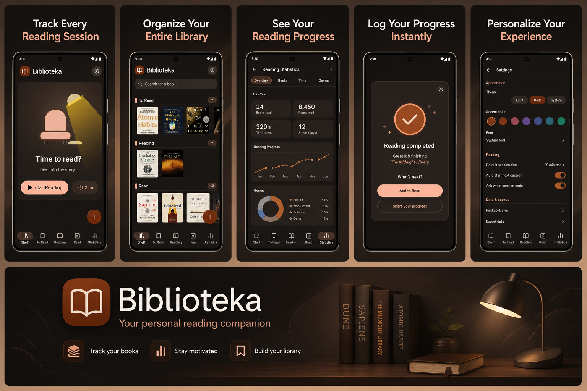

<div align="center">
   
</div>

<h1 align="center">Biblioteka</h1>


<div align="center">
   <h3>Your private, offline-first reading tracker for Android.</h3>
</div>

<div align="center">

[Features](#-features) • [Privacy](#-privacy) • [Tech Stack](#-tech-stack) • [Building](#-building) • [Contact](#%EF%B8%8F-contact) • [License](#%EF%B8%8F-license)

</div>

<br>



---

## ✨ Features

- **Three-shelf model** — *To Read*, *Reading*, *Read* — long-press a book and drag it to reorder it or move it to another shelf
- **Reading session timer** — log how long you spent with a book and the page you reached
- **Statistics dashboard** — books read and added this year, pages, reading time and a monthly progress chart
- **Quick view & rich edit** — cover image (system Photo Picker), rating (1–5 ★), private notes
- **Material You theming** — twelve seed colours plus a custom colour picker, with tonal palettes generated on-device
- **Light, dark and system themes**
- **29 first-class languages** — English, Polish, French, German, Spanish, Italian, Portuguese, Dutch, Czech, Slovak, Slovenian, Croatian, Hungarian, Romanian, Bulgarian, Greek, Turkish, all Nordic, Baltic, Luxembourgish, Korean, Japanese and Greenlandic — integrated with Android 13+ per-app language settings
- **JSON backup & restore** — via the Android share sheet / file picker; the format is compatible with backups made by the previous (web-based) version
- **Seamless upgrade** — on first launch the app imports the library saved by the previous Capacitor/WebView version

---

## 🔒 Privacy

Biblioteka is built around one principle: **your data is yours alone.**

- Everything lives in the app's private storage on your device
- **No** account · **No** server · **No** analytics · **No** crash reporter · **No** ads
- The app requests **no permissions at all** — covers come from the system Photo Picker, backups go through the share sheet / Storage Access Framework
- The app makes **zero network requests** — no `INTERNET` permission declared
- Android cloud backup and device-to-device transfer are disabled

The full privacy policy is available in-app under *Settings → About*, translated into all 29 supported languages.

---

## 🛠 Tech Stack

| Layer | Technology |
|---|---|
| Language | Kotlin 2.3 |
| UI | Jetpack Compose, Material 3 |
| Theming | MaterialKolor `material-color-utilities` (Material You tonal palettes from a seed colour) |
| Storage | Private JSON file (atomic writes) + JPEG covers, `org.json` |
| Localisation | Android string resources + AndroidX per-app language API |
| Android | minSdk 24 (Android 7.0), targetSdk 36, Java 17 bytecode |

### Project layout

```
app/src/main/java/com/biblioteka/app/
├── MainActivity.kt
├── data/            # model, pure business logic, JSON, storage, legacy migration
└── ui/              # Compose screens, sheets, components and theme
app/src/main/res/    # strings for 29 languages, icons
app/src/test/        # JVM unit tests for the business logic
```

---

## 🧱 Building

Requirements: Android Studio (or the Android SDK command-line tools) and JDK 17+.

```bash
./gradlew assembleDebug        # debug APK in app/build/outputs/apk/debug/
./gradlew testDebugUnitTest    # unit tests
./gradlew bundleRelease        # release bundle (configure signing first, see app/build.gradle.kts)
```

---

## ✉️ Contact

For questions or feedback, open an issue on GitHub or reach out at
[biblioteka@damiankokot.eu](mailto:biblioteka@damiankokot.eu)

---

## ©️ License

This project is licensed under the **MIT License**. See the [`LICENSE`](LICENSE) file for details.

---

